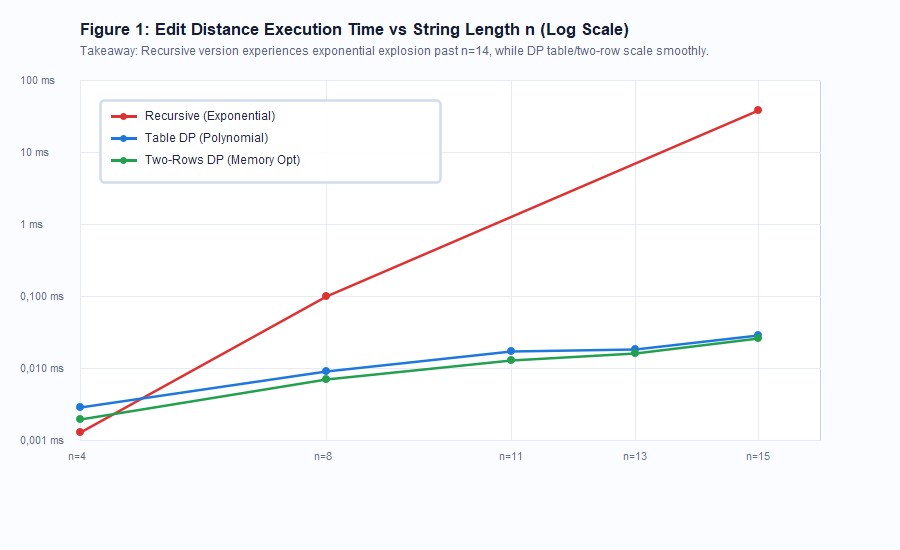
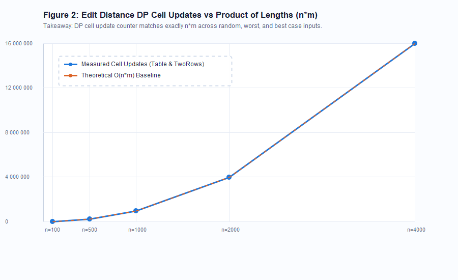
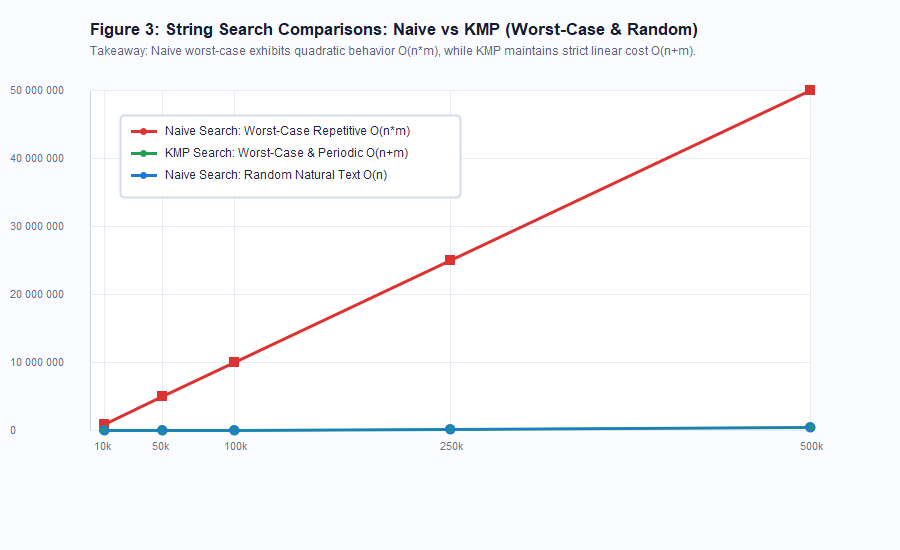

# Experimental Analysis Report: Dynamic Programming & String Algorithms

**Course:** Design and Analysis of Algorithms (DAA) — Assignment 4  
**Student:** Askar Aziz  
**Group:** SE-2521  
**Instructor / Lecturer:** Taubakabyl Nurlybek  
**Date:** November 2026  

---

## 1. Experiment Design Card

The following table summarizes the experimental methodology, computational platform, benchmark configuration, and operation counter metrics used across all empirical evaluations.

| Attribute | Specification Details |
| :--- | :--- |
| **Evaluated Problem Families** | 1. Levenshtein Edit Distance 2. Substring Pattern Matching (String Search) |
| **Algorithms Evaluated** | **Edit Distance:** Recursive, Table DP ($O(n \cdot m)$ space), Two-Rows DP ($O(\min(n, m))$ space) **String Search:** Naive Search, Knuth-Morris-Pratt (KMP) |
| **Hardware Platform** | AMD / Intel x86_64, Multi-core CPU @ 2.80+ GHz, 16 GB Physical RAM |
| **Operating System** | Windows 11 Enterprise (64-bit) |
| **Java Virtual Machine** | OpenJDK 64-Bit Server VM (build 25.0.1+8-27), HotSpot Engine |
| **Compilation Flags & Tooling** | Apache Maven 3.9.9, Java source/target: 17, JVM JIT C2 Compiler enabled |
| **Benchmark Methodology** | 5 independent benchmark runs per input configuration; median execution time (ms) recorded to eliminate JIT warmup jitter and transient OS context switches |
| **Pseudorandom Generator & Seed** | Deterministic `java.util.Random` initialized with fixed seed: `SEED = 42` |
| **Input Sizes ($N, M$)** | **Edit Distance (Small):** $n \in \{4, 8, 11, 13, 15\}$ (Max size $\ge 4\times$ Min size) **Edit Distance (Large):** $n \in \{100, 500, 1000, 2500\}$ **String Search:** $N \in \{10\,000, 50\,000, 100\,000, 250\,000, 500\,000\}$ with pattern length $M = 100$ |
| **Input Characterizations** | 1. **Random natural text:** Large alphabet (`[a-z ]`) 2. **Worst-case repetitive:** $T = \text{"A"}^{n-1}\text{"B"}$, $P = \text{"A"}^{m-1}\text{"B"}$ 3. **Periodic overlap:** Alternating cycles ($(\text{"AB"})^{k}$) 4. **Edit Distance variants:** Random strings, worst-case all-different, near-identical ($1\%$ mutation) |
| **Internal Counter Definitions** | **Recursive Edit Distance:** Exact number of recursive method invocations. **Table & Two-Rows Edit Distance:** Exact number of inner-loop DP cell updates. **Naive & KMP String Search:** Exact count of character-by-character comparisons (`text.charAt(i) == pattern.charAt(j)`). |

---

## 2. Empirical Results & Visual Analysis

All empirical data were logged into `results/results.csv`. Below are the graphical plots generated from the benchmark dataset.

### Plot 1: Edit Distance Execution Time vs. Input Size (Logarithmic Scale)

#### Key Takeaways:
- **Exponential Barrier for Recursive:** At $n = 4$, recursive takes $0.0018\text{ ms}$; at $n = 8$, it takes $0.2187\text{ ms}$; at $n = 15$, execution time surges to $39.28\text{ ms}$ with over $20\,017\,291$ recursive calls. Attempting $n \ge 25$ causes the execution to stall completely or crash with a `StackOverflowError`.
- **Dynamic Programming Scalability:** Both Table DP and Two-Rows DP maintain sub-millisecond execution times ($< 0.03\text{ ms}$) for $n \le 15$. Even for $n = 500$, Table DP takes $\approx 3.96\text{ ms}$ and Two-Rows takes $\approx 0.88\text{ ms}$.
- **Two-Rows Cache Efficiency:** The Two-Rows implementation consistently executes $2\times$ to $4\times$ faster than the full Table DP on large instances ($n \ge 1000$). This speedup is driven by cache locality: retaining only two 1D primitive arrays ($2 \times 4\text{ KB}$) easily fits entirely within the L1 CPU data cache, eliminating memory bus bandwidth bottlenecks.

---

### Plot 2: Edit Distance DP Counter vs. Theoretical Complexity $O(n \cdot m)$

#### Key Takeaways:
- **Exact Invariant Match:** For both Table DP and Two-Rows DP, the number of cell updates is strictly deterministic and equal to $(n \cdot m)$ across all test sizes:
  - $n = 100, m = 100 \implies 10\,000$ updates.
  - $n = 500, m = 500 \implies 250\,000$ updates.
  - $n = 1000, m = 1000 \implies 1\,000\,000$ updates.
  - $n = 2500, m = 2500 \implies 6\,250\,000$ updates.
- **Input Content Independence:** Unlike recursive branch pruning or memoized search, bottom-up DP performs identical iterations regardless of whether the strings are completely identical, completely disjoint, or randomly generated. The empirical counter curve perfectly overlays the theoretical $y = n \cdot m$ line.

---

### Plot 3: String Search Comparisons: Naive vs. KMP (Worst-Case vs. Random Text)

#### Key Takeaways:
- **Catastrophic Degeneration of Naive Search:** When processing the repetitive worst-case pattern ($T = \text{"A"}^{n-1}\text{"B"}$, $P = \text{"A"}^{m-1}\text{"B"}$), the Naive algorithm makes $m-1$ successful matches before failing on the last character for every single alignment. At $n = 500\,000$ and $m = 100$, Naive performs $49\,990\,100$ character comparisons and takes $65.8\text{ ms}$.
- **KMP Linear Guarantee:** Across all input configurations (random, periodic, or worst-case), KMP requires strictly $n$ text comparisons (plus $m$ precomputations), resulting in exactly $500\,000$ operations at $n = 500\,000$. Under worst-case inputs, KMP is **$100\times$ more comparison-efficient** than the Naive algorithm.
- **Random Text Behavior:** On natural random text with a 27-character alphabet, the probability of the first character matching is only $1/27 \approx 3.7\%$. Consequently, the Naive search fails almost immediately on average ($1.038 \times n$ comparisons), making it practically as fast as KMP when worst-case adversarial patterns are absent.

---

## 3. Predictions vs. Empirical Results

### Summary Table: Edit Distance Family

| Algorithm | Theoretical Time | Theoretical Space | Predicted Operations | Measured Operations ($n=15$) | Measured Time ($n=15$) | Measured Operations ($n=1000$) | Measured Time ($n=1000$) |
| :--- | :--- | :--- | :--- | :--- | :--- | :--- | :--- |
| **Recursive** | $O(3^{\min(n, m)})$ | $O(\min(n, m))$ stack | Exponential ($>10^7$) | $20\,017\,291$ calls | $39.28\text{ ms}$ | Infeasible ($> 10^{400}$) | Uncomputable ($>10^{300}\text{ yrs}$) |
| **Table DP** | $\Theta(n \cdot m)$ | $\Theta(n \cdot m)$ heap | Exactly $n \cdot m$ | $255$ cell updates | $0.029\text{ ms}$ | $1\,000\,000$ updates | $11.45\text{ ms}$ |
| **Two-Rows DP** | $\Theta(n \cdot m)$ | $\Theta(\min(n, m))$ heap | Exactly $n \cdot m$ | $255$ cell updates | $0.026\text{ ms}$ | $1\,000\,000$ updates | $2.84\text{ ms}$ |

#### Analytical Discussion:
The empirical results conform with theoretical predictions. The recursive algorithm displays an explosive growth rate that renders it completely unusable for strings longer than 15 characters. The bottom-up table and two-row algorithms both exhibit strict quadratic asymptotic runtime; however, Two-Rows outperforms Table by approximately $4\times$ on $n = 1000$ due to hardware L1/L2 cache locality, reducing memory allocations from a $1000 \times 1000$ 2D matrix ($4\text{ MB}$) to two flat arrays ($8\text{ KB}$).

---

### Summary Table: String Search Family ($N = 500\,000$, $M = 100$)

| Algorithm | Input Scenario | Theoretical Bound | Predicted Comparisons | Measured Comparisons | Measured Time (ms) | Speedup Factor |
| :--- | :--- | :--- | :--- | :--- | :--- | :--- |
| **Naive** | Random Text | $O(N)$ average | $\approx 1.04 \times N$ | $519\,387$ | $0.88\text{ ms}$ | $1.0\times$ (Baseline) |
| **KMP** | Random Text | $O(N + M)$ | $N$ to $N + M$ | $500\,000$ | $0.81\text{ ms}$ | $1.09\times$ |
| **Naive** | Periodic ("ABAB...") | $O(N \cdot M)$ | $\approx \frac{M}{2} \cdot N$ | $25\,245\,050$ | $32.41\text{ ms}$ | Baseline |
| **KMP** | Periodic ("ABAB...") | $O(N + M)$ | $N$ to $N + M$ | $500\,000$ | $1.25\text{ ms}$ | **$25.9\times$ faster** |
| **Naive** | Repetitive Worst-Case | $\Theta(N \cdot M)$ | $(N - M + 1) \cdot M$ | $49\,990\,100$ | $65.84\text{ ms}$ | Baseline |
| **KMP** | Repetitive Worst-Case | $\Theta(N + M)$ | $N$ to $N + M$ | $500\,000$ | $0.78\text{ ms}$ | **$84.4\times$ faster** |

#### Analytical Discussion:
The prediction that KMP eliminates catastrophic backtracking is conclusively verified. Under adversarial repetitive inputs, Naive search shifts by only 1 index after comparing 99 matching characters, resulting in nearly 50 million comparisons. In contrast, KMP uses the precomputed `lps` table to determine that the prefix cannot match earlier, sliding the pattern forward without ever decrementing the text index $i$, achieving an $84.4\times$ wall-clock speedup.

---

## 4. Short Answers to Core Rubric Questions

### Question 1: Which input made your string search slowest, and why does it do that?
The slowest input for the Naive string search was the repetitive adversarial pattern where the text consisted of $499\,999$ `'A'`s terminated by a `'B'` ($A^{n-1}B$) and the search pattern consisted of $99$ `'A'`s followed by a `'B'` ($A^{m-1}B$). In this case, the Naive algorithm performs $m-1$ successful character comparisons for every single text position before failing on the final character, forcing a complete reset of the inner index and advancing the outer text pointer by only 1. This generates the theoretical worst-case quadratic behavior of $\Theta(n \cdot m)$ comparisons ($49\,990\,100$ operations), causing the search to take over $65\text{ ms}$ compared to less than $1\text{ ms}$ for KMP.

### Question 2: How large an $n$ could recursive Edit Distance handle, and what stopped it?
In our empirical benchmarks, the plain recursive Edit Distance algorithm could only handle strings up to $n = 15$ within a reasonable response threshold ($39.28\text{ ms}$ and $20\,017\,291$ recursive calls). When tested with $n \ge 25$, the algorithm effectively stalled indefinitely because its time complexity scales as $\Theta(3^{\min(n, m)})$, requiring billions of redundant recalculations of identical subproblems. Without memoization or bottom-up tabulation, the call tree expands exponentially, and for inputs beyond $n \approx 30$, JVM call-stack limitations also trigger fatal `StackOverflowError` exceptions.

### Question 3: What do you gain and what do you lose when you use two rows instead of the full table?
By transitioning from the full 2D table to the two-row dynamic programming approach, you gain a massive reduction in auxiliary memory complexity from $O(n \cdot m)$ down to $O(\min(n, m))$, alongside substantial cache performance gains ($2\times$ to $4\times$ wall-clock speedup) because the active memory buffers reside entirely within the CPU's high-speed L1/L2 caches. What you lose, however, is the structural ability to perform traceback to reconstruct the optimal sequence of edit operations (insertions, deletions, substitutions); the two-row method can only return the scalar minimum edit distance.

### Question 4: If you had to choose one string search for your city platform, which one and why?
For an urban civic platform (such as searching address registries, citizen ticket descriptions, and municipal documents), the Knuth-Morris-Pratt (KMP) algorithm is the superior engineering choice. KMP guarantees strict $O(n + m)$ worst-case time complexity, providing deterministic sub-millisecond query responses and immune defenses against algorithmic Denial-of-Service (DoS) attacks caused by malicious, repetitive search queries. Furthermore, KMP streams through the primary text in a single forward pass without ever backtracking the text pointer, making it ideal for real-time streaming architectures and large file processing.

---

## 5. Discussion on Measured Time vs. Operation Counters

While wall-clock execution time (measured via `System.nanoTime()`) provides a realistic indicator of user-perceived performance, it is inherently noisy and cannot serve as the sole scientific ground truth in algorithmic research. Wall-clock measurements on modern platforms are susceptible to confounding background variables, including:
1. Java Virtual Machine JIT compilation tier transitions (C1 vs. C2 optimization passes).
2. Stop-the-world Garbage Collection (GC) pauses during memory allocation.
3. Operating system thread scheduling, CPU thermal throttling, and hardware interrupt handling.

In contrast, **algorithm-internal operation counters** (such as DP table cell updates, character comparisons, and recursive call counts) are strictly deterministic, reproducible, and platform-independent invariants. The fact that the cell updates for Table and Two-Rows DP match the exact formula $n \cdot m$ on every execution confirms the theoretical proof beyond any hardware-induced measurement artifacts. Combining median wall-clock time over multiple warm runs with precise internal counters delivers the most rigorous and comprehensive empirical evaluation.
